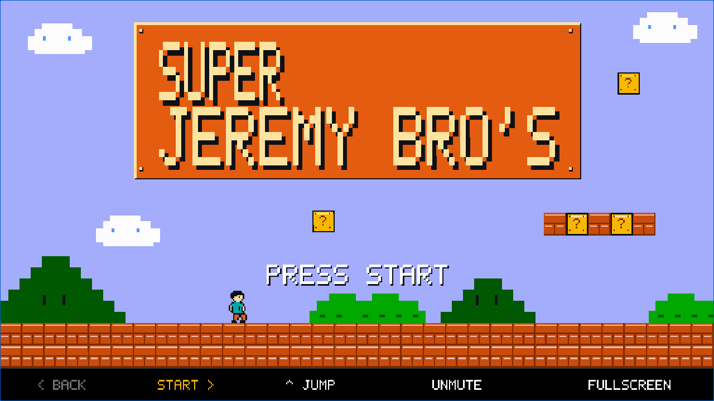

# Jeremy World — Interactive Story

A guided, pixel-art browser presentation that tells a personal story through a continuous side-scrolling world.

**Private source archive.** Jeremy authorized uploading this existing prototype privately. Its current screen title is “Super Jeremy Bro’s.” Mario-related audio, a supplied Bowser image, and personal presentation content require review before any public release.



*Captured from the existing application during portfolio review on 29 October 2026.*

## Experience

Instead of a conventional slide deck, the audience follows Jeremy through 26 story beats across six chapters. A presenter advances the story, pauses at questions, changes costumes through pipes, and reaches a scripted finale. Movement and encounters are choreographed; this is a guided presentation rather than a general-purpose platform game.

## Features

- A continuous 512 × 288 Canvas world scaled with crisp pixel edges.
- Forward and backward story navigation with manual question reveals.
- Animated costume changes and transitions between an overworld and dungeon.
- A scripted three-character boss encounter with reversible presentation state.
- Keyboard, mouse, and touch controls; fullscreen support where the browser permits it.
- Optional audio with mute preference saved locally; sound is unlocked by a user gesture.
- Accessible button labels and a live text announcement for each story beat.
- A deterministic simulation test that exercises the game’s real code without a browser.

## Technology and architecture

| Layer | Actual implementation |
| --- | --- |
| Game rendering | HTML Canvas 2D, JavaScript pixel sprites, bitmap lettering |
| Story and animation | Plain JavaScript state machine, fixed 1/60-second update steps, requestAnimationFrame |
| Sound | Bundled MP3 files and optional Web Audio sound effects |
| Browser preference | `localStorage` for mute preference |
| Verification | Node.js VM simulation with mocked browser and audio objects |
| Optional hosting wrapper | React with Vinext/Vite; its home page embeds the standalone game in an iframe |

```text
public/play/
  index.html       Standalone browser entry and controls
  style.css        Screen scaling, presentation controls, and accessible text
  game.js          Story beats, state transitions, input, timing, and audio
  renderer.js      Canvas world and visual drawing routines
  sprites.js       Pixel-grid character and object frames
  font.js          Bitmap alphabet
  assets/          Bundled boss image and MP3 files; rights review required
tests/
  simulation.cjs   Existing deterministic simulation and assertions
app/page.tsx       Optional hosted page: an iframe around /play/index.html
vite.config.ts    Vinext/Cloudflare/Sites hosting configuration
```

The game itself has no React dependency, account system, API server, or database. The hosting package contains framework and UI-template dependencies; those do not describe the game engine. No runtime AI API is used.

## Run the standalone presentation

Open `public/play/index.html` in a modern browser. The game and bundled media can run locally without installing project dependencies.

For a consistent browser origin, serve the files using Python 3:

```sh
python3 -m http.server 8000 --bind 127.0.0.1 --directory public/play
```

Then open `http://127.0.0.1:8000`.

| Control | Action |
| --- | --- |
| Right Arrow, Space, Enter | Advance a story beat |
| Left Arrow | Return to an earlier beat |
| Up Arrow | Jump while paused |
| M | Toggle sound |
| F | Toggle fullscreen |

The archive also preserves the optional React/Vinext hosting wrapper and its `npm run dev` / `npm run build` scripts. `vite.config.ts` imports `.openai/hosting.json`; that platform-specific file, generated hosting output, caches, and local deployment state are intentionally excluded from the repository. The wrapper therefore requires your own hosting configuration or an adapted Vite configuration before those commands can run. The standalone `public/play/index.html` route does not depend on that metadata and is the reviewed run path. The wrapper was not built or validated as a portable release.

## Verify the story sequence

With Node.js installed, run from the repository root:

```sh
node tests/simulation.cjs
```

During portfolio preparation, this existing test passed in an isolated source copy. It checked all 26 beats, reversible navigation, manual question gates, both costume cycles, dungeon isolation, the three-hit encounter, and audio/mute state. The four game JavaScript files also passed syntax checks. A browser loaded the title screen without a JavaScript page error and produced the screenshot above.

The simulation uses browser and audio mocks. It does not replace full browser, screen-reader, mobile-device, or audio playback testing. The separate hosting-wrapper build was not run.

## My role and AI-assisted development

I developed the idea, product direction, and design direction, drawing inspiration from existing websites. I decided what the experience should do and used **Codex** to generate and revise the implementation.

The source inspection and existing simulation run described here were performed during portfolio preparation. Supplied media is credited as supplied; its authorship and redistribution rights still require confirmation.

## Assets and personal content

The current package contains `bowser.png`, `mario-theme.mp3`, `level-complete.mp3`, and `pipe.mp3`. No grant for public redistribution was found in the reviewed project. The Mario-inspired title and visuals also need review before a public release. Replace these with original or clearly licensed characters, imagery, and audio for a stronger independent portfolio identity.

The story includes location history, academic plans, test scores, and named public figures. Confirm that those details are accurate, current, and suitable for public display. Presentation claims should not automatically become professional-profile claims.

No general open-source license has been selected. Supplied media is not claimed as Jeremy’s original work.

## Publication recommendation

**Private archive authorized by Jeremy.** Keep this complete source and media package private. Permission and suitability for public redistribution have not been established. A future public edition should use cleared assets, its own title and visual identity, reviewed personal content, and approved screenshots.
